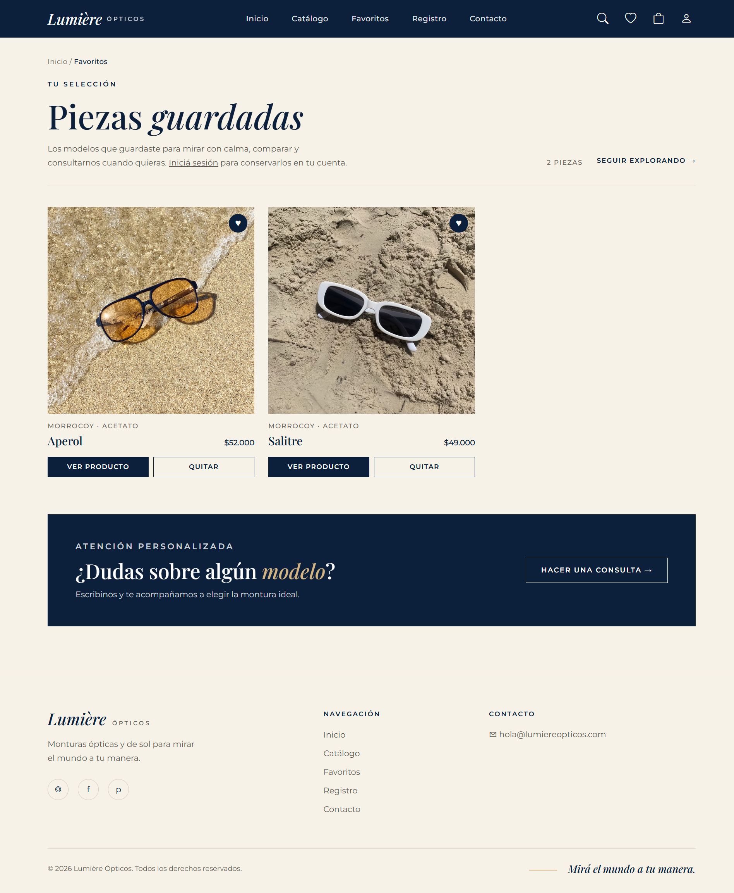
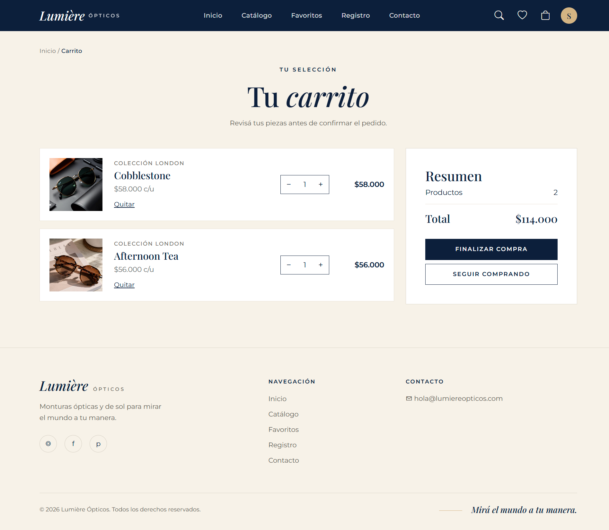
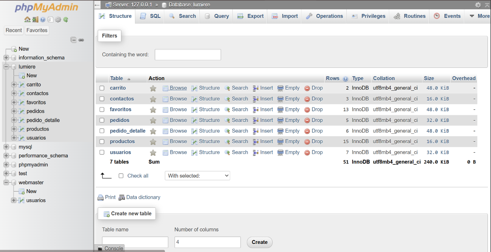

# Lumière Ópticos

**Lumière Ópticos** es un sitio web de catálogo y compra de monturas ópticas, desarrollado como proyecto académico. Combina una interfaz de estilo editorial con funcionalidades dinámicas para consultar productos, gestionar cuentas, guardar favoritos, utilizar un carrito y registrar pedidos.

Repositorio: [proyecto-web-2](https://github.com/swdiazup/proyecto-web-2)

## Tecnologías y entorno

- **HTML y CSS:** estructura visual, navegación y diseño adaptable.
- **PHP:** generación de páginas dinámicas, procesamiento de solicitudes, autenticación y sesiones.
- **MySQL / MariaDB:** almacenamiento de productos, usuarios, consultas y operaciones de compra.
- **XAMPP:** entorno local con Apache y base de datos.
- **phpMyAdmin:** importación y administración de la base de datos.

## Navegación del sitio

1. **Inicio (`index.php`):** presenta la identidad visual de Lumière y permite acceder a las demás secciones.
2. **Catálogo (`catalogo.php`):** muestra los productos consultados desde MySQL. Permite buscar, filtrar por colección, forma, color o material y ordenar los resultados.
3. **Detalle de producto (`producto.php?id=...`):** muestra la información de una montura seleccionada a partir de su identificador.
4. **Favoritos (`favoritos.php`):** permite guardar y consultar productos preferidos. Los favoritos de usuarios autenticados se almacenan en la base de datos.
5. **Cuenta (`registro.php`):** reúne los formularios de registro e inicio de sesión, además de la opción para cerrar sesión.
6. **Recuperación (`recuperar.php`):** sección destinada a recuperar el acceso a la cuenta mediante los datos de seguridad configurados.
7. **Carrito (`carrito.php`):** permite agregar productos, modificar cantidades, quitar artículos, consultar el total y finalizar un pedido.
8. **Contacto (`contacto.php`):** contiene el formulario para enviar una consulta.

Las colecciones del catálogo son **Morrocoy, London, Azul, Ámbar y Vértice**.

## Funcionamiento técnico

### Catálogo y productos

`catalogo.php` consulta la tabla `productos` y construye el listado de manera dinámica. Los filtros y el ordenamiento se envían mediante parámetros **GET**; PHP compone la consulta a la base de datos según las opciones elegidas. Al seleccionar un producto, se abre `producto.php` con su identificador en la URL, por ejemplo:

```text
http://localhost/lumiere/producto.php?id=1
```

### Registro e inicio de sesión

Los formularios de `registro.php` envían la información mediante **POST**.

- **Registro:** valida los campos, comprueba que el correo no esté registrado y crea un nuevo registro en `usuarios`. La contraseña se guarda como hash mediante `password_hash()`; también se registra la pregunta de seguridad y su respuesta protegida.
- **Inicio de sesión:** busca el correo ingresado y verifica la contraseña con `password_verify()`.
- **Sesión:** cuando las credenciales son correctas, PHP almacena los datos básicos del usuario en `$_SESSION["usuario"]`. Otras páginas consultan esa variable para reconocer al usuario y asociar sus datos.
- **Cierre de sesión:** permite salir desde la sección de cuenta.

**Importante:** el archivo SQL compartido incluye la estructura de `usuarios`, pero no cuentas precargadas. Para probar el inicio de sesión después de instalar el sitio, hay que crear una cuenta desde el formulario de registro.

### Favoritos

`favoritos.php` permite agregar o retirar productos de la lista. Cuando existe un usuario autenticado, la relación entre el usuario y el producto se guarda en la tabla `favoritos` usando `id_usuario` e `id_producto`. El código también contempla una lista temporal de favoritos en la sesión.

### Carrito y pedidos

`carrito.php` administra los productos asociados al usuario, sus cantidades y los subtotales. Al finalizar una compra, el servidor registra un pedido en la tabla `pedidos` y sus artículos en `pedido_detalle`. Estas operaciones se realizan dentro de una **transacción** de base de datos, para mantener la consistencia de los datos. Después de guardar el pedido, se vacía el carrito.

> La finalización aquí documentada corresponde al registro del pedido dentro del sistema; no implica necesariamente una integración con una pasarela de pagos externa.

### Formulario de contacto

El usuario completa los campos de nombre, correo electrónico, asunto y mensaje en `contacto.php`. El formulario envía los datos por **POST** a `recibirContacto.php`. Este archivo valida que los campos no estén vacíos y ejecuta una sentencia `INSERT` preparada para guardar la consulta en `contactos`, junto con la fecha de envío. Si la operación se completa, redirige a `contacto.php?enviado=1`.

## Base de datos

La base de datos se llama **`lumiere`** y su estructura se encuentra en [`lumiere.sql`](lumiere.sql). Está compuesta por las siguientes tablas:

| Tabla | Función |
| --- | --- |
| `productos` | Información de monturas, precios, colecciones, características e imágenes. |
| `usuarios` | Cuentas registradas y datos de autenticación y recuperación. |
| `favoritos` | Asociación entre usuarios y productos favoritos. |
| `contactos` | Consultas recibidas mediante el formulario. |
| `carrito` | Productos y cantidades seleccionados por cada usuario. |
| `pedidos` | Cabecera de cada pedido, con usuario, fecha e importe total. |
| `pedido_detalle` | Productos, cantidades y precios correspondientes a cada pedido. |

**Relaciones principales:** `favoritos` y `carrito` vinculan usuarios con productos; `pedidos` se asocia con usuarios, y `pedido_detalle` relaciona cada pedido con sus productos.

## Instalación y ejecución local

1. Instalar **XAMPP** y abrir su panel de control.
2. Activar los servicios **Apache** y **MySQL**.
3. Descargar o clonar el repositorio y colocar la carpeta del proyecto dentro de `htdocs` (por ejemplo, `C:\xampp\htdocs\lumiere`).
4. Abrir [phpMyAdmin](http://localhost/phpmyadmin/) y crear una base de datos llamada `lumiere` si aún no existe.
5. Seleccionar esa base de datos, elegir **Importar** y cargar el archivo `lumiere.sql` incluido en el repositorio.
6. Revisar los datos de acceso a la base de datos configurados en `includes/conexion.php` y adaptarlos al entorno local si fuera necesario.
7. Abrir el sitio en el navegador:

   ```text
   http://localhost/lumiere/
   ```

8. Navegar por el catálogo y crear una cuenta de prueba desde `registro.php` para probar las funciones asociadas a usuarios.

**Nota:** si la carpeta descargada tiene otro nombre, hay que usar ese nombre en la dirección `localhost` o renombrarla a `lumiere`.

## Organización de archivos

```text
proyecto-web-2/
├── css/                 # Hojas de estilo
├── img/productos/       # Imágenes de productos
├── includes/            # Componentes compartidos y conexión a MySQL
├── index.php            # Página principal
├── catalogo.php         # Catálogo y filtros
├── producto.php         # Detalle de producto
├── favoritos.php        # Favoritos
├── carrito.php          # Carrito y pedidos
├── registro.php         # Registro, inicio y cierre de sesión
├── recuperar.php        # Recuperación de acceso
├── contacto.php         # Formulario de contacto
├── recibirContacto.php  # Procesamiento del formulario
├── lumiere.sql          # Estructura y datos de la base de datos
└── README.md            # Documentación del proyecto
```

## Capturas de pantalla


## Capturas de pantalla

### 1. Página de inicio
Vista principal de Lumière Ópticos, con acceso al catálogo y a las diferentes secciones del sitio.


### 2. Catálogo de productos
Visualización de los productos disponibles, organizados por colecciones.


### 3. Detalle del producto
Información individual de cada montura, incluyendo sus características y precio.


### 4. Registro e inicio de sesión
Formularios que permiten crear una cuenta e iniciar sesión para acceder a las funcionalidades del sitio.


### 5. Favoritos
Sección donde los usuarios pueden consultar y administrar sus productos favoritos.



### 6. Carrito de compras
Visualización de los productos seleccionados, modificación de cantidades y cálculo del total del pedido.



### 7. Formulario de contacto
Formulario para enviar consultas mediante PHP y almacenar la información en MySQL.


### 8. Base de datos MySQL
Vista general de las siete tablas que componen la base de datos del proyecto.



### 9. Estructura de la tabla productos
Visualización de los campos, tipos de datos y claves de la tabla productos.


### Página de inicio
<!--  -->

### Catálogo y navegación de productos
<!--  -->

### Detalle de producto
<!--  -->

### Registro e inicio de sesión
<!--  -->

### Favoritos y carrito
<!--  -->
<!--  -->

### Formulario de contacto
<!--  -->

### Estructura de la base de datos
<!--  -->

## Autoría

Proyecto académico desarrollado por **Stephanie Díaz**.

GitHub: [@swdiazup](https://github.com/swdiazup)
